# terminal-terrarium 🪼🌸🌳

**Living ASCII art for your terminal**: jellyfish, lily bouquets, bonsai that grow, trees that live and
die in time-lapse, whales, koi, a city skyline from dusk to dawn, a volcano, aurora and more.
Every scene is procedurally generated, so no two runs look the same.

This repo has two parts:

1. **[`terrarium`](#the-package-terrarium)**: one zero-dependency Python package with dozens of
   animated scenes and a lot of knobs.
2. **[The collection](#the-collection-the-best-terminal-animations-out-there)**: a curated list of
   the best terminal animations other people have made, with how to install each one.

<p align="center">
  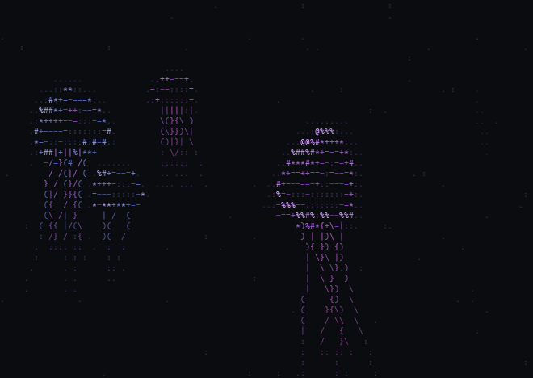
  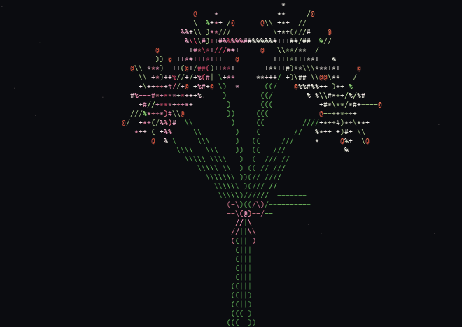
  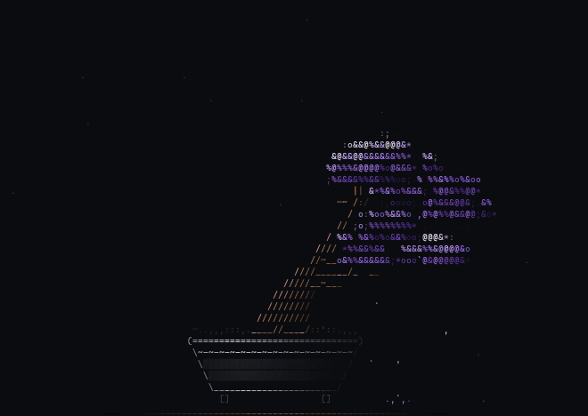
  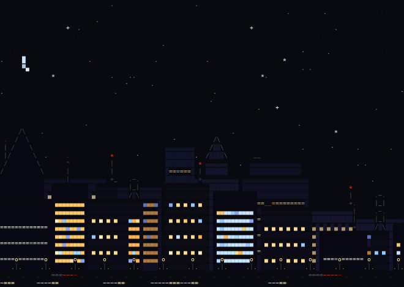
  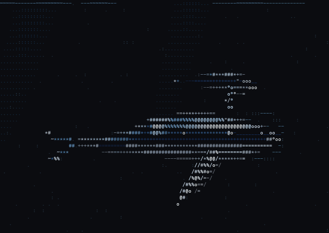
  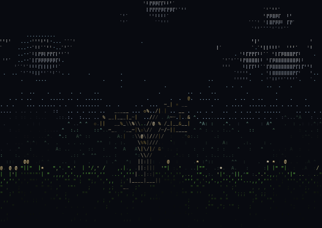
  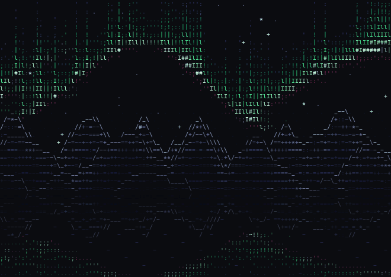
  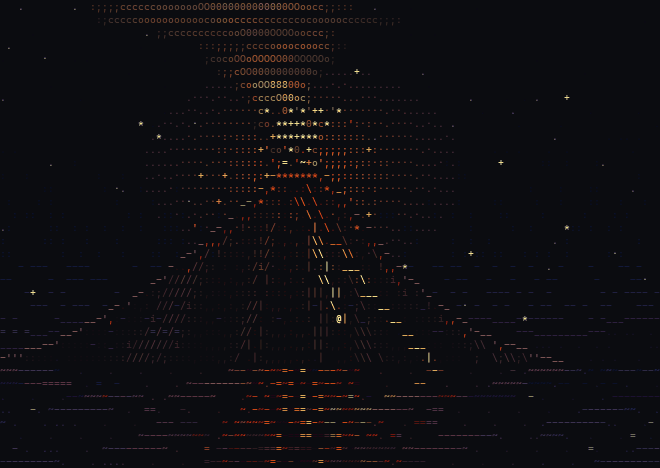
  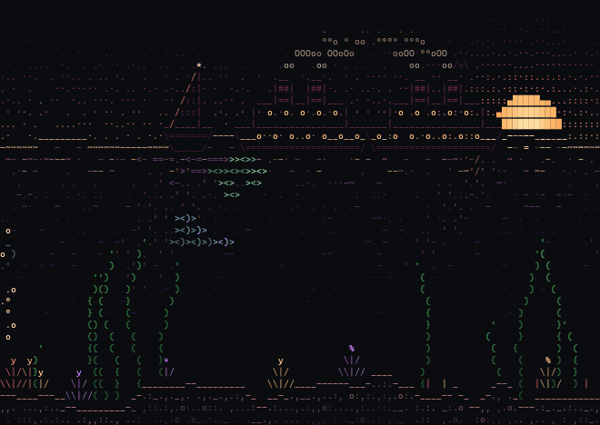
  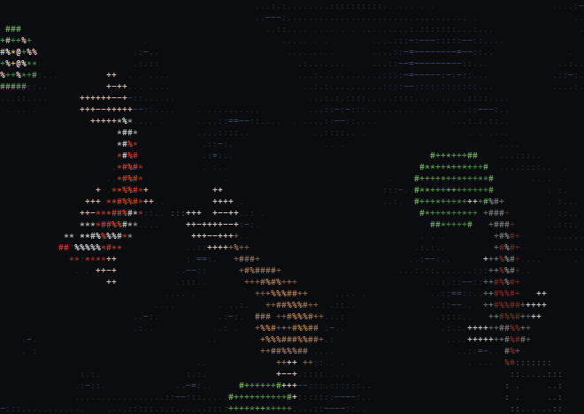
  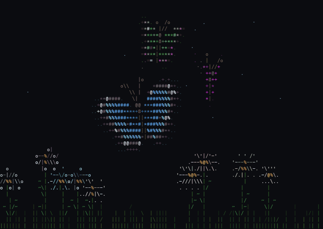
  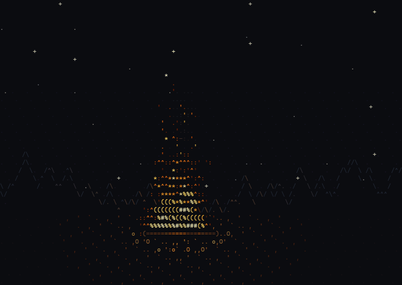
  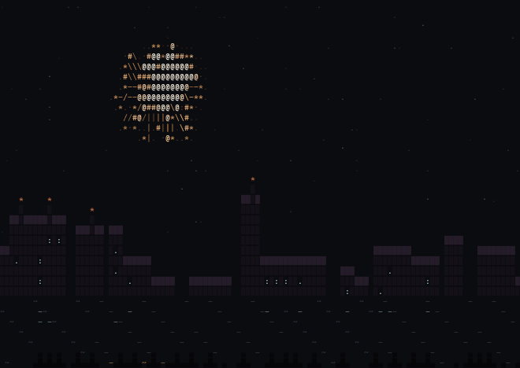
  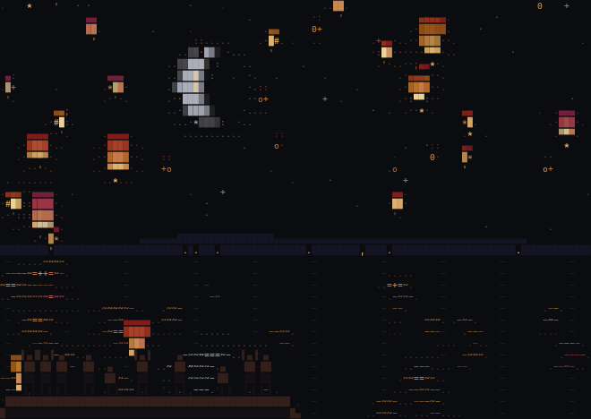
  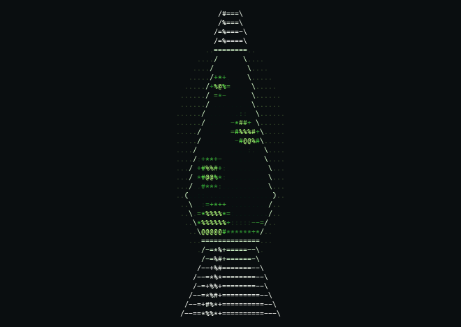
</p>

> The previews are rendered straight from the code with `--record`, at a small size. In a real
> full-screen terminal you get many more cells, so there's more detail.

---

## The package: `terrarium`

### Install

Needs Python 3.9+ and nothing else.

```sh
pipx install git+https://github.com/AsafMeizner/terminal-terrarium
# or
uv tool install git+https://github.com/AsafMeizner/terminal-terrarium
# or
pip install git+https://github.com/AsafMeizner/terminal-terrarium
```

To export PNGs/GIFs as well, install the `export` extra (it adds Pillow), e.g.
`pipx install "terminal-terrarium[export] @ git+https://github.com/AsafMeizner/terminal-terrarium"`.

Works in Windows Terminal, macOS Terminal/iTerm2, and Linux terminals. It uses truecolor, falling back
to 256 colors or mono. A dark background looks best.

### Use

```sh
terrarium                          # a random scene
terrarium jellyfish                # one scene
terrarium bonsai sakura --cycle 40 # rotate between scenes every 40 s
terrarium --all --shuffle --cycle 30   # screensaver mode
terrarium --tag ocean --cycle 30   # every scene tagged 'ocean'
terrarium jellyfish -t vapor -o count=9 -s 0.6
terrarium bonsai -o style=cascade --charset blocks
terrarium --list                   # all scenes
terrarium --info bonsai            # a scene's own options
```

When you quit, it prints the seed it used. Run with `--seed N` to get that exact variation back.

### Keys while it runs

| key | | key | |
|---|---|---|---|
| `space` | pause | `t` / `T` | next / previous theme |
| `n` `→` / `p` `←` | next / previous scene | `c` | next charset |
| `r` | reseed: a new variation | `h` | rotate hue +30° |
| `+` / `-` | faster / slower | `i` | info bar (scene, seed, fps) |
| `]` / `[` | more / fewer things | `?` | help |
| `q` `esc` | quit | | |

### Options

| flag | what it does |
|---|---|
| `-t, --theme NAME` | recolor any scene: `natural` (default), `neon`, `pastel`, `faded`, `sunset`, `ocean`, `forest`, `ember`, `ice`, `vapor`, `aurora`, `candy`, `matrix`, `amber`, `mono`, `nord`, `dracula`, `gruvbox`, `catppuccin`, `rainbow` |
| `--charset NAME` | shading characters: `ascii`, `fine`, `soft`, `blocks`, `dots`, `braille`, `lines`, `binary`, `stars` |
| `--hue DEG`, `--saturation X`, `--brightness X` | global color adjustments |
| `-s, --speed X` | animation speed |
| `-d, --density X` | how many things (fish, petals, stars...) |
| `--seed N` | reproducible variation |
| `-o KEY=VAL` | scene options, e.g. `-o palette=pink`; see `terrarium --info SCENE` |
| `--fps N` | target frame rate (default 30) |
| `-a, --all`, `--tag TAG`, `--cycle SECS`, `--shuffle` | playlists and screensaver mode |
| `--duration SECS` | quit after a while (nice in a shell startup file) |
| `--message TEXT` | a caption in the middle of the screen |
| `--color auto\|truecolor\|256\|mono` | force a color mode |
| `--hud`, `--no-title`, `--no-alt-screen` | interface bits |
| `--snapshot FILE` | render one frame to `.png`, `.txt` or `.ans` |
| `--record FILE.gif` | record a GIF (`--size WxH`, `--frames N`, `--warmup SECS`, `--font`, `--font-size`) |
| `--new NAME`, `--path DIR` | make your own scene / load scenes from a folder |

### Scenes

<!-- scenes:start -->

**34 scenes.** Every one is procedurally generated: run it twice and you get two different pictures.

### Flowers

| | scene | |
|---|---|---|
| 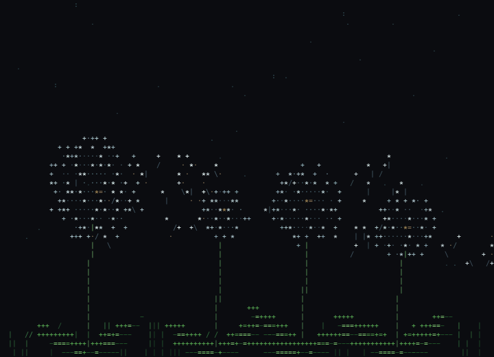 | **`dandelion`** | dandelion clocks in the wind, seeds drifting off on curling paths<br><sub>options: `heads`, `wind`, `mood`</sub> |
| 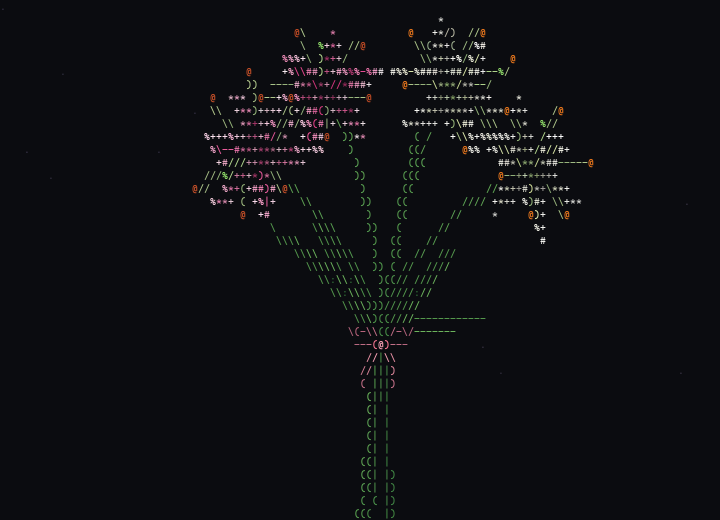 | **`lilies`** | a bouquet of lilies swaying and breathing, pollen drifting in the light<br><sub>options: `count`, `color`, `sway`, `ribbon`</sub> |
| 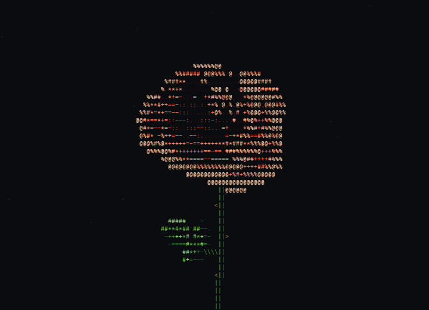 | **`rose`** | a single rose unfurling from a bud, dropping a petal now and then<br><sub>options: `color`, `bloom`, `loop`</sub> |

### Trees & plants

| | scene | |
|---|---|---|
| 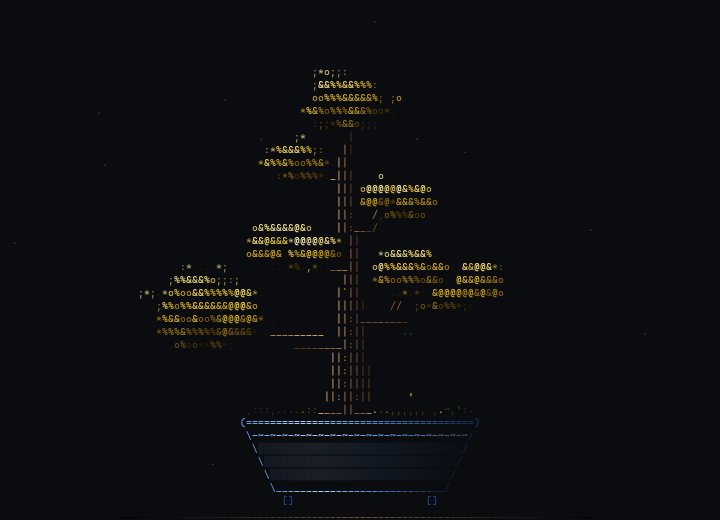 | **`bonsai`** | a bonsai grows from its pot, sways, sheds leaves and regrows<br><sub>options: `speed`, `style`, `leaves`, `pot`, `grow`, `life`, `fall`</sub> |
| 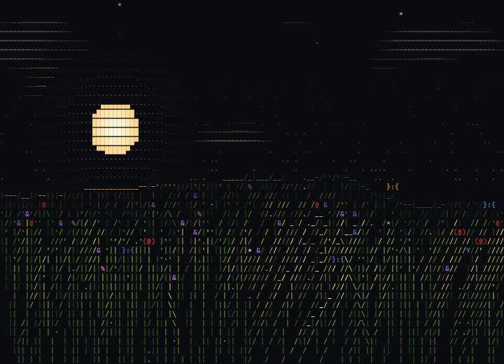 | **`meadow`** | a golden-hour meadow: grass waves in the wind, flowers bob, butterflies flutter<br><sub>options: `wind`, `mood`, `grass`, `flowers`, `butterflies`, `sky`</sub> |
| 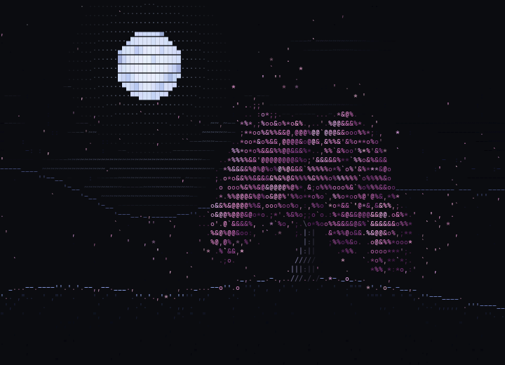 | **`sakura`** | a cherry tree on a hill at dusk, petals swirling in gusty wind<br><sub>options: `petals`, `wind`, `time`, `shape`</sub> |
| 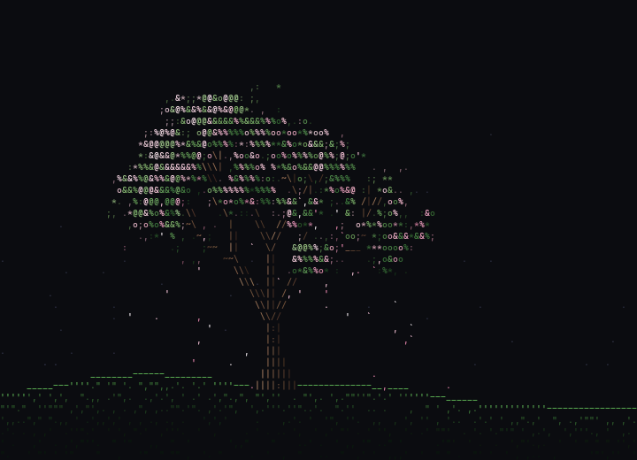 | **`seasons`** | one tree through the year: blossom, summer green, autumn fall, winter snow<br><sub>options: `length`, `start`, `lock`, `tree`</sub> |
| 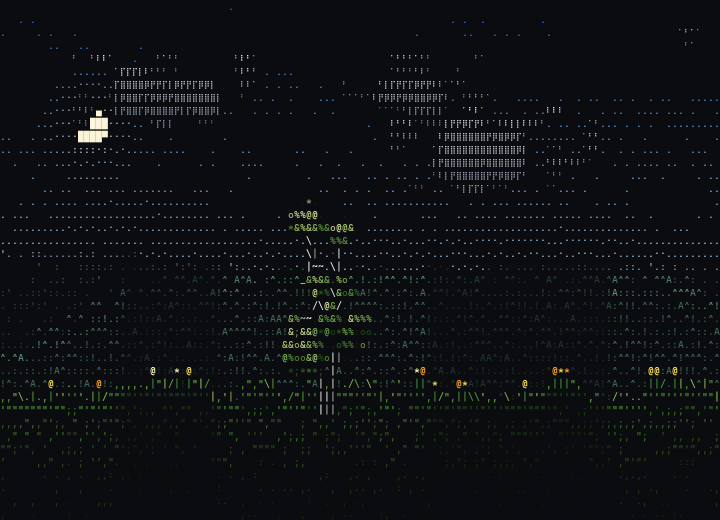 | **`timelapse`** | a tree's whole life in time-lapse: days flash by as it sprouts, grows, ages, falls and a new one rises<br><sub>options: `life`, `species`, `day`</sub> |
| 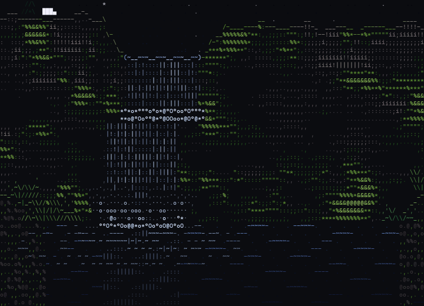 | **`waterfall`** | a waterfall pouring from a mossy cliff into a misty pool, ferns swaying at its edge<br><sub>options: `flow`, `mist`, `rainbow`, `time`</sub> |

### Creatures

| | scene | |
|---|---|---|
| 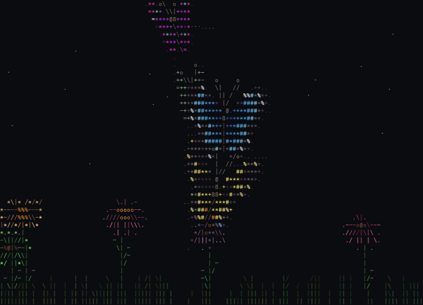 | **`butterflies`** | big patterned butterflies and moths flutter through a night garden and rest on flowers<br><sub>options: `count`, `family`, `flowers`, `trail`</sub> |
| 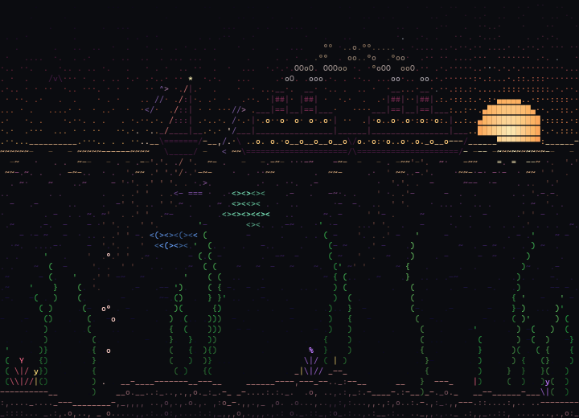 | **`seascape`** | a cross-section of the sea: boats and leaping dolphins above, fish and kelp below<br><sub>options: `time`, `boats`, `dolphins`, `fish`</sub> |

### Water & ocean

| | scene | |
|---|---|---|
| 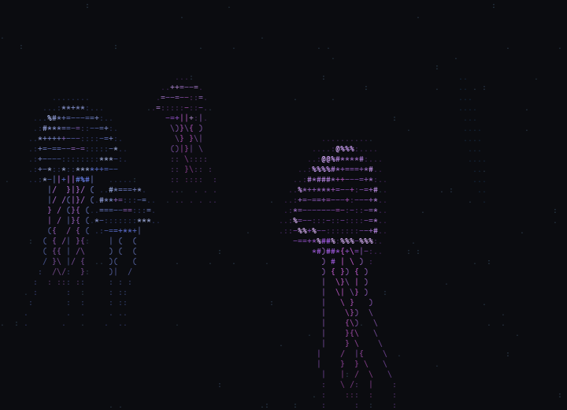 | **`jellyfish`** | bioluminescent jellyfish pulsing through deep water<br><sub>options: `count`, `palette`, `snow`, `rays`</sub> |
| 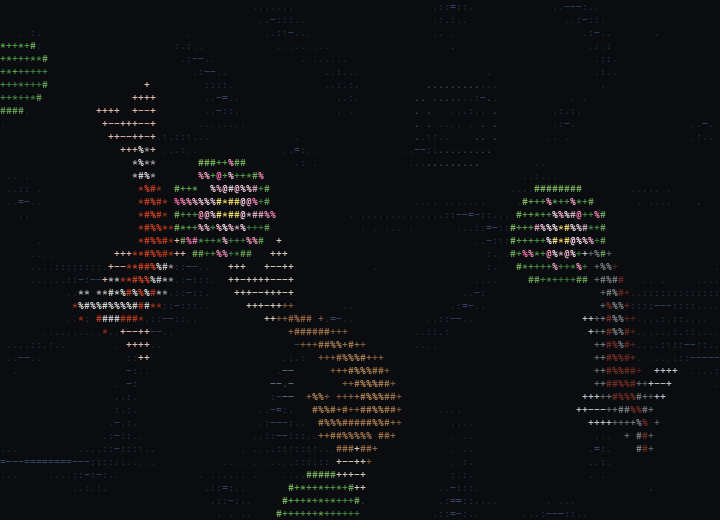 | **`koi`** | koi winding under lily pads and lotus flowers, ripples spreading on the water<br><sub>options: `fish`, `pads`, `ripples`</sub> |
| 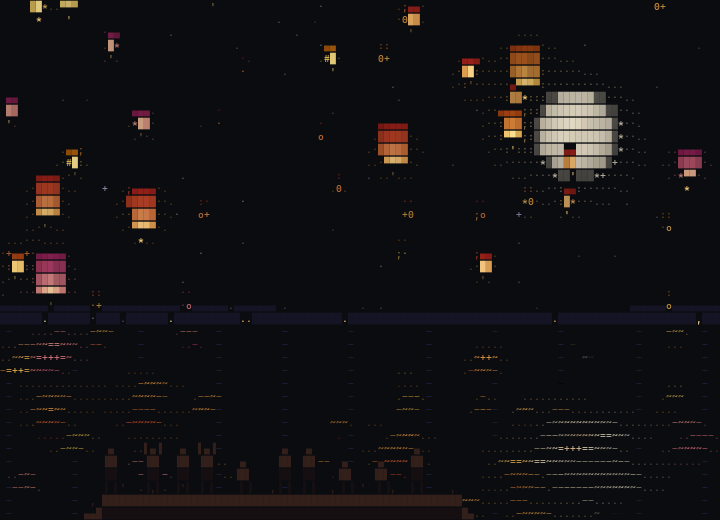 | **`lanterns`** | paper sky lanterns rising over a calm lake at night, glowing in the water<br><sub>options: `count`, `wind`, `colors`, `moon`</sub> |
| 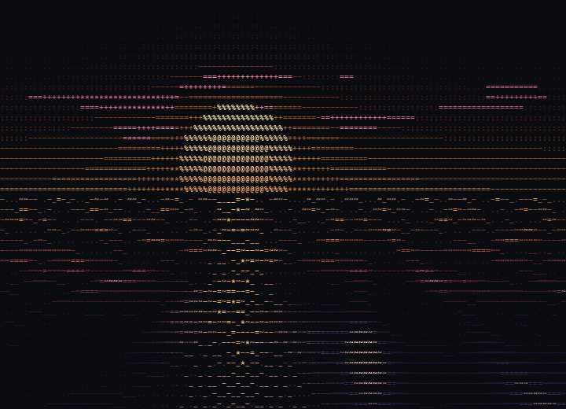 | **`ocean`** | a glowing sun on the horizon of a rolling sea<br><sub>options: `time`, `waves`, `gulls`</sub> |
| 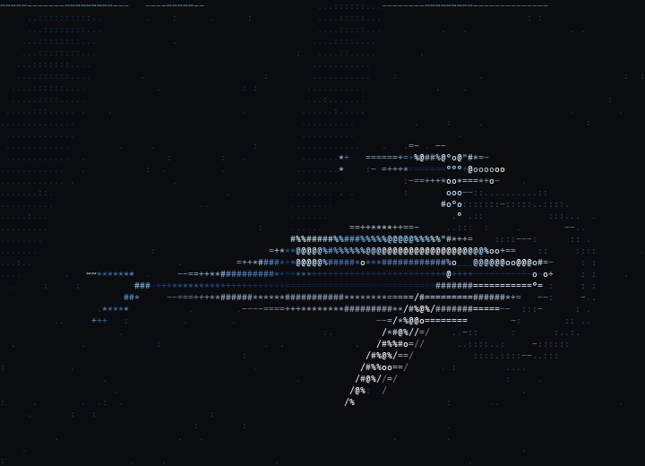 | **`whale`** | a giant humpback whale gliding through deep blue water (or through space)<br><sub>options: `calf`, `space`, `rays`</sub> |

### Space

| | scene | |
|---|---|---|
| 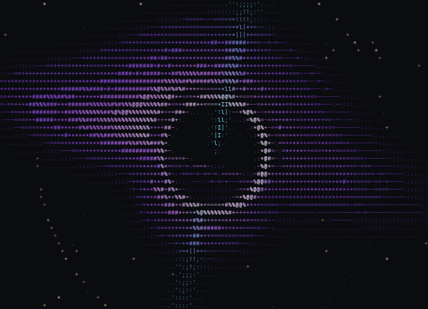 | **`blackhole`** | a black hole bending light: lensed accretion disk, photon ring, Doppler glow and jets<br><sub>options: `tilt`, `jets`, `palette`, `stars`</sub> |
| 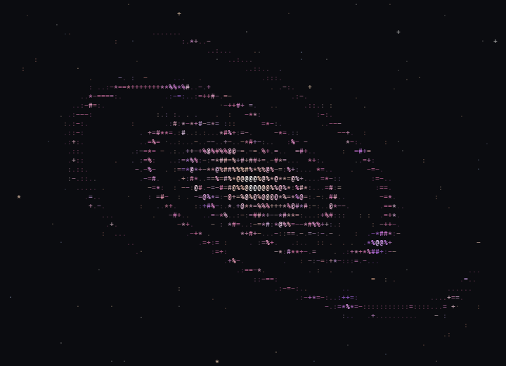 | **`galaxy`** | a rotating spiral galaxy with a golden core, blue arms and pink nebulae<br><sub>options: `arms`, `tilt`, `pitch`, `bar`, `spin`, `palette`, `nebulae`, `stars`</sub> |
| 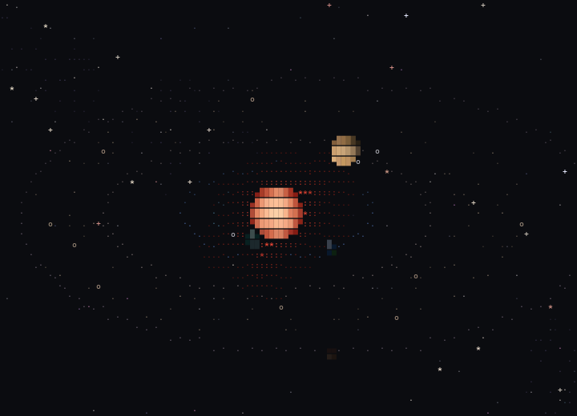 | **`solar`** | a star with shaded planets on tilted orbits, rings, moons and the odd comet<br><sub>options: `planets`, `speed`, `orbits`, `star`</sub> |
| 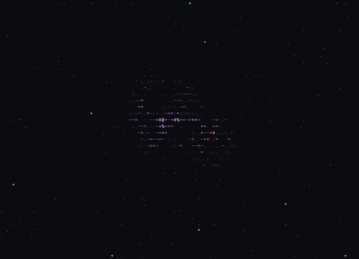 | **`starfield`** | flying through space past streaking stars and drifting nebulae<br><sub>options: `speed`, `warp`, `stars`, `nebulae`, `palette`</sub> |

### Sky, weather & places

| | scene | |
|---|---|---|
| 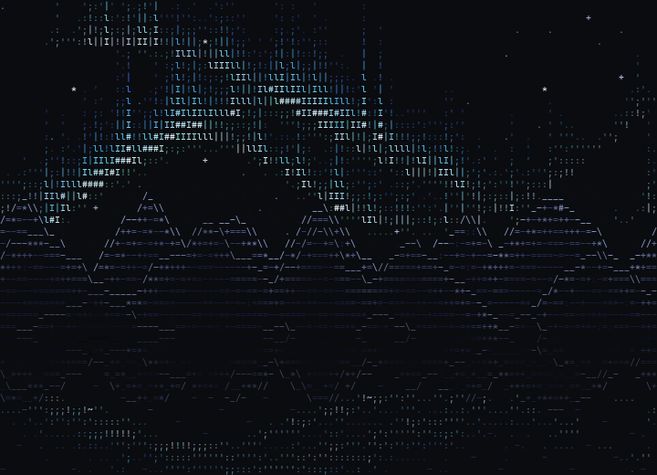 | **`aurora`** | northern lights rippling over dark mountains and a still lake<br><sub>options: `intensity`, `colors`, `reflection`, `curtains`</sub> |
| 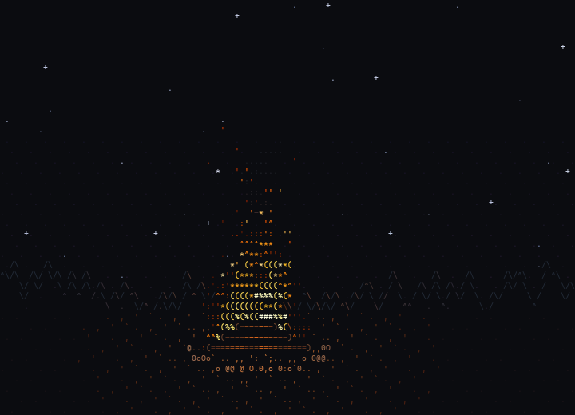 | **`campfire`** | a crackling campfire under the stars, with sparks and drifting smoke<br><sub>options: `size`, `sparks`, `wind`, `palette`</sub> |
| 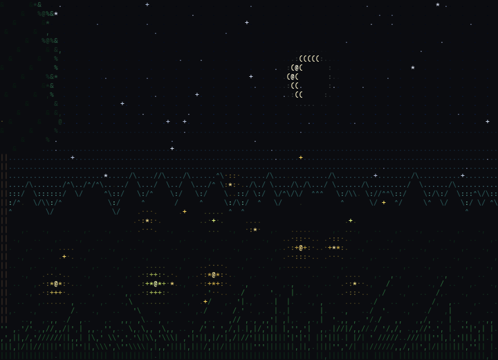 | **`fireflies`** | fireflies blinking over a summer meadow at the edge of a forest<br><sub>options: `count`, `color`</sub> |
| 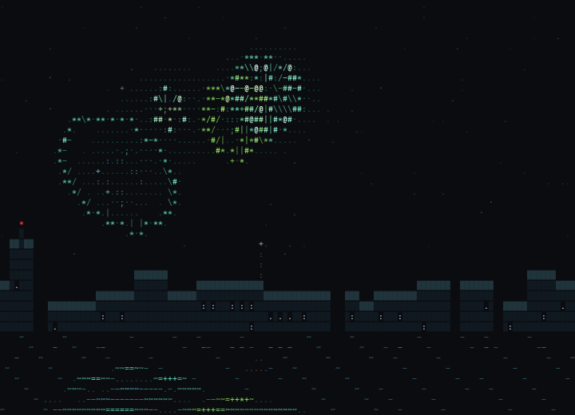 | **`fireworks`** | a fireworks show over a lake or a harbour city, with smoke, reflections and a finale<br><sub>options: `intensity`, `finale`, `backdrop`, `palette`</sub> |
| 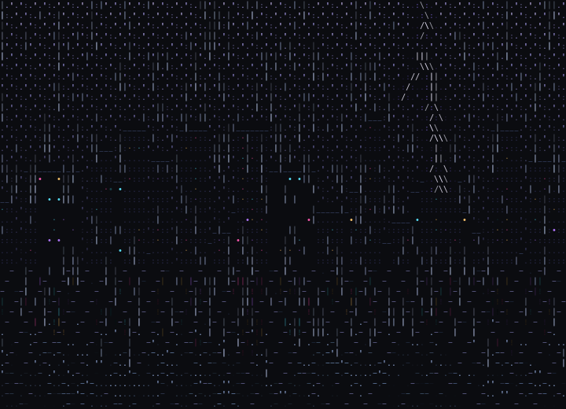 | **`rain`** | night rain over a city, with splashes, ripples and lightning<br><sub>options: `intensity`, `wind`, `lightning`, `skyline`</sub> |
| 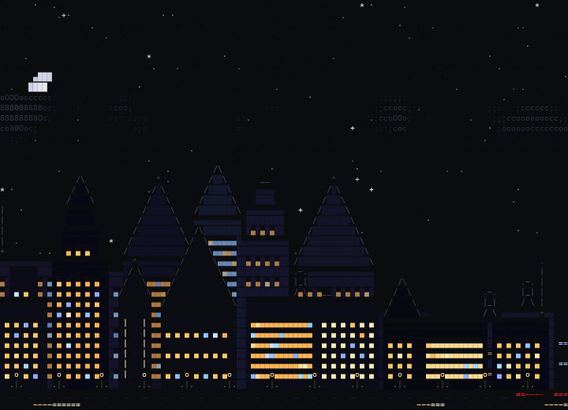 | **`skyline`** | a city skyline time-lapse: day to night, windows lighting up, traffic streaming below<br><sub>options: `cycle`, `density`, `start`, `clouds`</sub> |
| 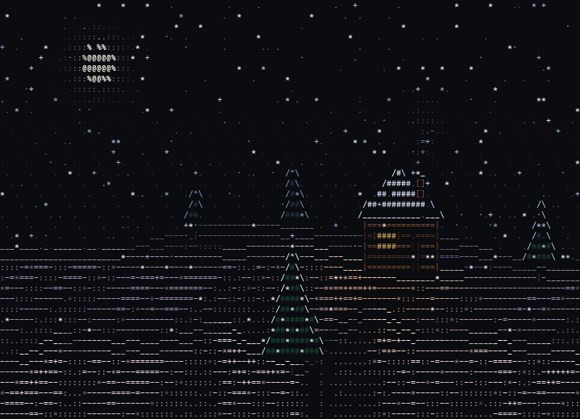 | **`snow`** | snow falling softly over moonlit hills and a cabin with a warm window<br><sub>options: `amount`, `wind`, `cabin`</sub> |
| 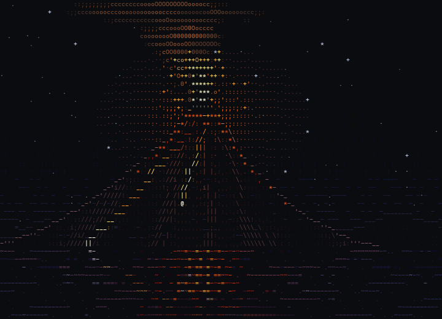 | **`volcano`** | a volcano at night erupting in cycles: lava fountains, flows and a glowing ash plume<br><sub>options: `frequency`, `intensity`, `plume`, `style`, `base`, `shake`</sub> |

### Abstract & retro

| | scene | |
|---|---|---|
| 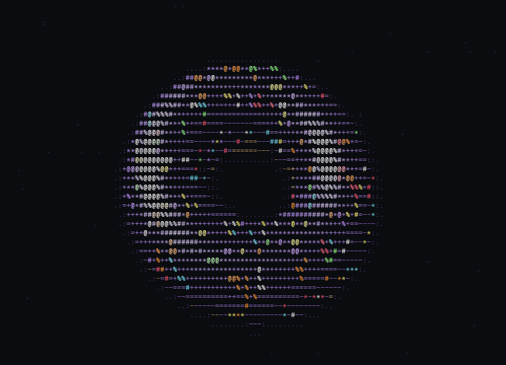 | **`donut`** | a spinning 3D donut with frosting, sprinkles and golden dough (or a planet, or a cube)<br><sub>options: `shape`, `frosting`, `spin`, `sprinkles`</sub> |
| 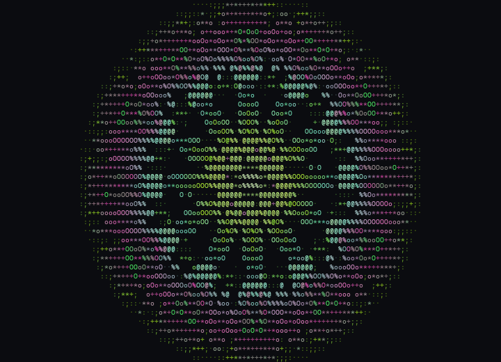 | **`kaleidoscope`** | a breathing N-fold mandala of mirrored glass in drifting jewel tones<br><sub>options: `symmetry`, `palette`, `speed`</sub> |
| 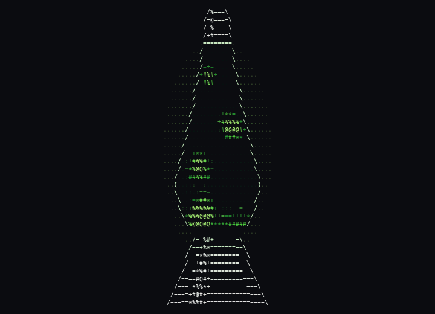 | **`lavalamp`** | glowing wax blobs rising, merging and sinking in a lava lamp<br><sub>options: `lamp`, `colors`, `blobs`, `viscosity`</sub> |
| 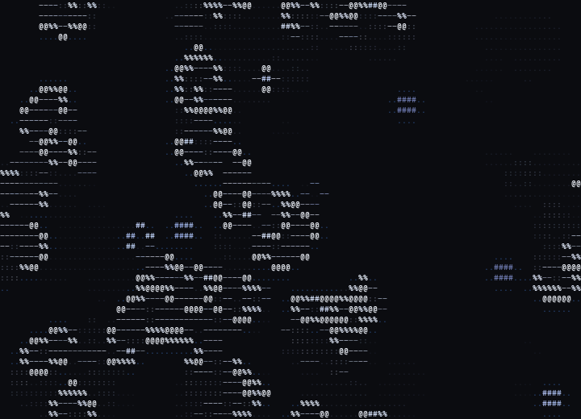 | **`life`** | Conway's Game of Life on a torus, colored by age with fading ghosts<br><sub>options: `rule`, `palette`, `start`, `speed`, `reseed`, `fill`, `cell`</sub> |
| 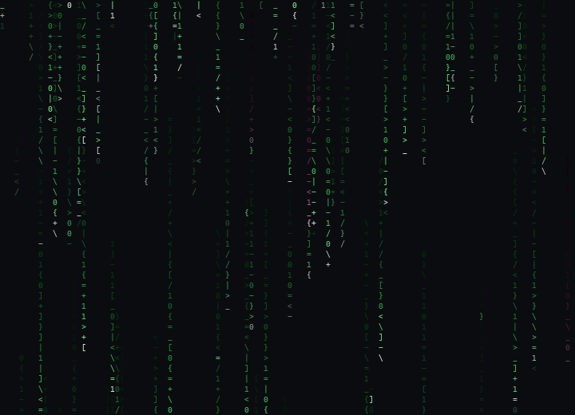 | **`matrix`** | falling columns of glyphs with white-hot heads and green trails<br><sub>options: `color`, `density`, `glyphs`</sub> |
| 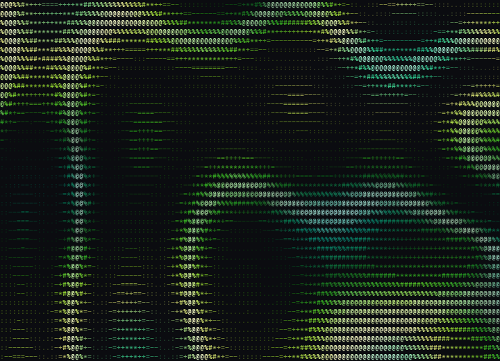 | **`plasma`** | demoscene plasma: interfering sine waves through cycling palettes<br><sub>options: `palette`, `scale`, `cycle`</sub> |

<!-- scenes:end -->

### Make your own scene

A scene is one Python file. Generate a working template, then edit it:

```sh
terrarium --new northern_lights --path ~/.terrarium/scenes
terrarium northern_lights        # files in ~/.terrarium/scenes are picked up automatically
```

Scenes are also loaded from any folder in `$TERRARIUM_PATH` or passed with `--path`. A plugin that
reuses a built-in name replaces that scene, so you can tweak a built-in without forking.

The whole API is a canvas with a `shade(x, y, brightness, color)` call plus some noise and color
helpers. See **[CONTRIBUTING.md](CONTRIBUTING.md)** for the API, the rules (single-width characters,
seeded randomness, roll the *structure* so every run looks different), and how to check your scene.
To contribute a scene back, put the file in `terrarium/scenes/`, run
`python scripts/make_gifs.py NAME` for a screenshot and `python scripts/update_readme.py` to add it
to the list above, then open a PR. CI runs the tests on Windows, macOS and Linux.

### How it works

- `terrarium/engine.py`: a cell canvas with an intensity layer (`max`/`add`/`over` compositing), a
  diffing ANSI renderer that only redraws changed cells, a cached color pipeline (themes, hue,
  saturation, brightness, 256-color fallback), and non-blocking keyboard input on Windows and POSIX.
- `terrarium/scenes/`: one file per scene, auto-discovered. Each scene rolls its own "genome" from
  the seed: branch odds and angles, petal counts, palettes, layouts.
- `terrarium/export.py`: renders frames offline to PNG/GIF with Pillow. That's how the previews in
  this README are made.

---

## The collection: the best terminal animations out there

Projects by other people, collected because they're beautiful. Star counts were checked on
2026-11-15. Install lines come from each project's own README. Go star them.

### 🌳 Trees, flowers & gardens
| project | what | install |
|---|---|---|
| [cbonsai](https://gitlab.com/jallbrit/cbonsai) (C, GPL-3.0, ★434 on GitLab) | the classic: grows a bonsai in your terminal | `brew install cbonsai` |
| [csakura](https://github.com/realstrawhat/csakura) (MIT, ★272) | a sakura tree with falling petals | `brew install realstrawhat/csakura/csakura` · `yay -S csakura` |
| [PyBonsai](https://github.com/Ben-Edwards44/PyBonsai) (Python, MIT, ★148) | procedural ASCII trees, very configurable | `git clone` + `sudo bash install.sh` |
| [nysakura](https://github.com/77nyan/nysakura) (Rust, MIT) | a tall cherry tree that grows and sheds petals | `yay -S nysakura` |
| [flores](https://github.com/DCCXXV/flores) (Go, MIT, ★23) | flowers in your terminal | `git clone` + `go install` |
| [GitGarden](https://github.com/ezraaslan/GitGarden) (Python, MIT) | your GitHub contribution graph as ASCII flowers and trees | `git clone` + `python main.py` |

### 🌊 Oceans & aquariums
| project | what | install |
|---|---|---|
| [asciiquarium](https://github.com/cmatsuoka/asciiquarium) (Perl, ★1.3k) | the legendary ASCII aquarium | `brew install asciiquarium` / your package manager |
| [lifecycler](https://github.com/cxreiff/lifecycler) (Rust, MIT, ★187) | a terminal aquarium (Bevy Game Jam entry) | `cargo install lifecycler --locked` |
| [sipedon](https://github.com/bczsalba/sipedon) (Python, MIT) | an interactive aquarium | `pip install sipedon` |
| [Aquarium](https://github.com/agiletalk/Aquarium) (Swift, MIT) | a healing aquarium with named fish, jellyfish, rare whale visits | `brew install agiletalk/tap/aquarium` |

### 🌧️ Weather, sky & screensavers
| project | what | install |
|---|---|---|
| [weathr](https://github.com/Veirt/weathr) (Rust, GPL-3.0, ★3.1k) | your real weather as an ASCII animation | `cargo install weathr` · `brew install Veirt/veirt/weathr` |
| [drift](https://github.com/phlx0/drift) (Go, MIT, ★788) | idle screensaver: constellations, rain, particles | `brew install phlx0/drift/drift` · `go install github.com/phlx0/drift@latest` |
| [terminal-rain-lightning](https://github.com/rmaake1/terminal-rain-lightning) (Python, MIT, ★494) | rain and lightning | `pipx install git+https://github.com/rmaake1/terminal-rain-lightning.git` |
| [ttysvr](https://github.com/cxreiff/ttysvr) (Rust, Apache-2.0, ★488) | a set of terminal screensavers | `cargo install --locked ttysvr` · `brew install cxreiff/tap/ttysvr` |
| [orbitty](https://github.com/aywski/orbitty) (Rust, MIT) | idle screensaver with spinning planets | `cargo install --path .` |
| [halo](https://github.com/programmersd21/halo) (Python, MIT) | Perlin flow-field screensaver in braille | `pip install git+https://github.com/programmersd21/halo.git` |
| [metrocity](https://github.com/Itz-Agasta/metrocity) (Rust, MIT) | pixel-art city scenes take over your idle shell | `cargo install metrocity` |
| [tanim](https://github.com/SantiagoSchez/tanim) (MIT) | 20+ procedural pixel-art scenes in true color | `git clone` + `make install` |

### 🔥 Cozy
| project | what | install |
|---|---|---|
| [lavat](https://github.com/AngelJumbo/lavat) (C, MIT, ★633) | metaball lava lamp | `git clone` + `sudo make install` |
| [fireplace](https://github.com/Wyatt915/fireplace) (C, MIT, ★97) | a cozy fireplace | `make` (needs ncurses) |
| [YuleLog](https://github.com/Duroktar/YuleLog) (Python, BSD-3, ★80) | a Yule log fireplace | `pip install YuleLog` |

### 🟩 The classics
| project | what | install |
|---|---|---|
| [cmatrix](https://github.com/abishekvashok/cmatrix) (C, GPL-3.0, ★5.3k) | Matrix digital rain | your package manager |
| [unimatrix](https://github.com/will8211/unimatrix) (Python, GPL-3.0, ★2k) | Matrix rain with half-width katakana | `pip install git+https://github.com/will8211/unimatrix.git` |
| [neo](https://github.com/st3w/neo) (C++, ★974) | cmatrix clone with 32-bit color | `make` |
| [pipes.sh](https://github.com/pipeseroni/pipes.sh) (Bash, MIT, ★3.1k) | animated pipes screensaver | `brew install pipes-sh` |
| [sl](https://github.com/mtoyoda/sl) (C, ★3.4k) | a steam locomotive for when you mistype `ls` | your package manager |
| [no-more-secrets](https://github.com/bartobri/no-more-secrets) (C, GPL-3.0, ★7.8k) | the *Sneakers* decryption effect | your package manager |
| [cava](https://github.com/karlstav/cava) (C, MIT, ★6.5k) | audio visualizer | your package manager |
| [tty-clock](https://github.com/xorg62/tty-clock) (C, BSD-3, ★1.2k) | a big terminal clock | your package manager |

### ✨ Engines & big collections
| project | what | install |
|---|---|---|
| [terminaltexteffects](https://github.com/ChrisBuilds/terminaltexteffects) (Python, MIT, ★4.3k) | dozens of text effects, as an app and a library | `pipx install terminaltexteffects` |
| [ascii-magic-art](https://github.com/kailashsr38/ascii-magic-art) (JS, MIT, ★441) | 734 animated ASCII pieces you can browse in the terminal | `npx ascii-magic-art --list` |
| [ASCII-Art](https://github.com/RipperdocNiladri/ASCII-Art) (Python, MIT, ★171) | real-time ASCII rendering experiments | `pip install terminal-ascii-art` |
| [cinetty](https://github.com/JosssphZhou/cinetty) (Python, MIT) | cinematic terminal animations your coding agent writes from a YAML file (works as a Claude Code skill) | `git clone` + `make setup` |

### 🌐 Same aesthetic, in the browser
| project | what |
|---|---|
| [bas3line/ascii](https://github.com/bas3line/ascii) (TS, MIT, ★1.2k) | animated ASCII art components for web pages |
| [living-ascii](https://github.com/yusen-dev/living-ascii) (JS, MIT) | turns a still image into a seamless swaying ASCII loop |
| [motes](https://github.com/lucasmarkes/motes) (TS, MIT) | procedural, pointer-reactive ASCII backgrounds (WebGL2) |
| [Ascii-Animals-extension](https://github.com/Pawan-webdeveloper/Ascii-Animals-extension) (JS, MIT) | a new-tab page with ASCII koi, butterflies and jellyfish |

Know a great one that's missing? Open a PR and add a row.

---

## Credits & inspiration

- **The spark:** [@arimecoa's "ASCII lily bouquet" reel](https://www.instagram.com/reel/De1IvFqSihx/),
  and the wave of "vibe-coded" ASCII jellyfish, flowers and bonsai going around in 2026. The
  `lilies` scene is a tribute to it.
- **Ideas these scenes build on.** No code was copied from any of them; every scene here is an
  original implementation:
  - `bonsai`, `sakura`: the tradition of [cbonsai](https://gitlab.com/jallbrit/cbonsai) and [csakura](https://github.com/realstrawhat/csakura)
  - `donut`: Andy Sloane's [donut.c](https://www.a1k0n.net/2011/07/20/donut-math.html)
  - `campfire`: the Doom PSX fire algorithm, as explained by [Fabien Sanglard](https://fabiensanglard.net/doom_fire_psx/)
  - `lavalamp`: Jim Blinn's metaballs, and [lavat](https://github.com/AngelJumbo/lavat)
  - `matrix`: [cmatrix](https://github.com/abishekvashok/cmatrix) and *The Matrix*
  - `life`: John Conway's Game of Life
  - `butterflies`, `koi`, and other creature scenes: [asciiquarium](https://github.com/cmatsuoka/asciiquarium) for proving that ASCII can be alive
  - `blackhole`: Gargantua from *Interstellar*
  - `plasma`, `starfield`, `kaleidoscope`: classic demoscene effects
- Built by [Asaf Meizner](https://github.com/AsafMeizner) with Claude Code.

## License

MIT for this repo's code. Projects in the collection keep their own licenses.
